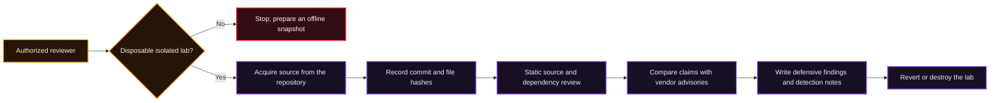
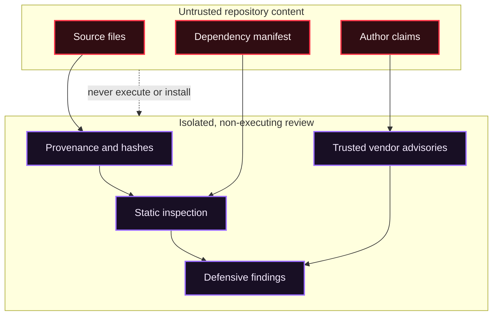

<p align="center">
  <strong>OUTLAW ROOTKIT — DEFENSIVE RESEARCH BRIEF</strong><br>
  <sub>Safe documentation for isolated, non-executing source review</sub>
</p>

<p align="center">
  <a href="https://github.com/dntaskmehow/OutLawRootkit"></a>
  
  
</p>

> [!CAUTION]
> **Do not run this project on a host, network, or virtual machine containing valuable data.** This repository describes rootkit and malware-like behavior. This README deliberately provides a **source-review workflow only**: it does not provide instructions to execute, install, persist, hide, control, or deploy the software. A disclaimer is not authorization. Review only in an isolated environment you own or are explicitly authorized to assess.

---

## At a glance

OutLawRootkit is presented by its author as a cross-platform rootkit research project. Its README makes claims about Linux and Windows targeting, concealment, persistence, command-and-control, credential access, and data collection. Those claims should be treated as **unverified statements**, not as validated capabilities or proof of working vulnerabilities.

This landing page is organized around safe review: establish a disposable lab, inspect the repository without executing its code, assess claims against trusted sources, and record defensive observations.

```text
ISOLATE → ACQUIRE → INSPECT → VERIFY CLAIMS → DOCUMENT → DISPOSE
```

## Review workflow



## Project claims and safe review focus

| Area described by the project | Safe reviewer question | Defensive focus |
|---|---|---|
| Privilege escalation | Are vulnerability and platform claims backed by authoritative advisories and reproducible, non-destructive evidence? | Patch status, vendor advisories, kernel and OS security controls |
| Concealment and hooks | What code paths could falsify ordinary process, file, or network views? | Compare independent telemetry sources; preserve trusted offline collection tools |
| Persistence | Does the source attempt to alter startup or boot configuration? | Baseline startup state; audit service, scheduled-task, boot, and firmware changes |
| Remote communication | Does the source contain network endpoints or remote-control logic? | Deny unexpected egress; review DNS, proxy, firewall, and endpoint telemetry |
| Sensitive data access | Does it enumerate or read credential-bearing locations? | Protect and rotate potentially exposed credentials; review access logs |
| Build and dependencies | Are dependencies pinned, maintained, and necessary? | Review dependency metadata without installing project requirements |

These are investigation categories, not confirmation that the behavior works. Do not rely on ordinary in-guest process listings alone when evaluating suspected kernel- or boot-level tampering.

## Full safe setup: isolated source-review lab

This setup acquires the files for **inspection only**. It does not install project dependencies or launch the project script.

### 1. Prepare the environment

Use a disposable virtual machine with a clean snapshot. Keep networking disabled (or use a host-only network with no route to production or the internet), disable shared folders, clipboard, drag-and-drop, and USB passthrough, and do not attach personal credentials or secrets. Take a baseline snapshot before acquiring files.

| Setting | Recommended review value |
|---|---|
| VM | Disposable, non-production guest |
| Network | Disconnected; host-only only when needed for controlled file transfer |
| Shared resources | Shared folders, clipboard, and device passthrough disabled |
| Credentials | No personal, cloud, SSH, or work credentials in the guest |
| Recovery | Snapshot before review; revert or destroy after review |

### 2. Acquire source and record provenance

Run these commands in the disposable review VM. Inspect the repository and commit before opening or processing files with other tools.

```bash
git clone --no-checkout https://github.com/dntaskmehow/OutLawRootkit.git
cd OutLawRootkit
git checkout --detach main

git rev-parse HEAD
git status --short
find . -maxdepth 2 -type f -print | sort
```

For a reproducible review, record the commit ID, acquisition date, reviewer, and any file hashes in your case notes. Do not treat a branch name as an immutable version identifier.

```bash
# Record hashes of tracked files without executing them.
git ls-files -z | xargs -0 sha256sum > ../outlawrootkit-source-sha256.txt
```

### 3. Inspect files without running project code

Read source and dependency manifests as text. Do **not** run `outlaw_rootkit.py`, install `requirements.txt`, invoke an installer, or run project-provided commands. If you need analysis tools, install them in a separate disposable environment from trusted package sources and review their provenance first.

```bash
# Inspect the entrypoint and dependency declarations as text.
sed -n '1,240p' outlaw_rootkit.py
cat requirements.txt

# Search source for areas that merit manual defensive review.
grep -RniE 'subprocess|Popen|socket|exec\(|eval\(|ctypes|registry|service|cron|EFI|credential|token' \
  --include='*.py' --include='*.txt' .
```

Searching is triage, not proof: matches can be benign, and absence of a match does not establish safety.

### 4. Optional syntax-only check

If Python is available, compilation checks syntax and writes bytecode; it does not establish safety or verify behavior. Run it only in the disposable review VM, then remove the generated cache before exporting reviewed artifacts.

```bash
python3 -m py_compile outlaw_rootkit.py
find . -type d -name __pycache__ -prune -exec rm -rf {} +
```

Do not import the project as a substitute for static review: imports can execute module-level code.

### 5. Finish and dispose

Keep notes and hashes separate from the sample. Export only the review artifacts you need, verify that they contain no secrets, then revert the VM snapshot or destroy the guest. If a system may have been exposed to a sample, treat credentials present in that environment as potentially compromised and follow your incident-response process.

## Defensive triage checklist

| Check | Evidence to preserve | Response direction |
|---|---|---|
| Unexpected startup changes | Service/task configuration, startup entries, file timestamps | Compare against a known-good baseline and investigate unauthorized changes |
| Unexplained privilege or kernel activity | EDR/kernel telemetry, audit events, boot measurements | Validate with trusted tools and known-good recovery media |
| Unexpected outbound connections | DNS, firewall, proxy, and flow logs | Contain the host and investigate the destination and process lineage |
| Credential-file access | Endpoint telemetry and identity-provider audit logs | Revoke or rotate exposed secrets; review account activity |
| Boot or firmware integrity alerts | Secure Boot and measured-boot records, firmware configuration | Follow vendor recovery guidance and trusted re-imaging procedures |

When compromise is suspected, prioritize containment and evidence preservation. Do not use a possibly compromised host as the sole source of truth.

## Repository contents

| Path | Review purpose |
|---|---|
| `outlaw_rootkit.py` | Primary source file; review as text only |
| `requirements.txt` | Dependency declarations; do not install as part of this review workflow |
| `README.md` | Project claims and safe-review guidance |

## Mermaid: defensive analysis boundary



## Legal and safety

Use this repository only for lawful defensive research in an environment you own or are explicitly authorized to assess. This documentation is not an endorsement, operational guide, or assurance that the code is safe or functional. The repository's license governs its code; consult the repository license file for the applicable terms. Security findings should be reported through responsible disclosure channels.
